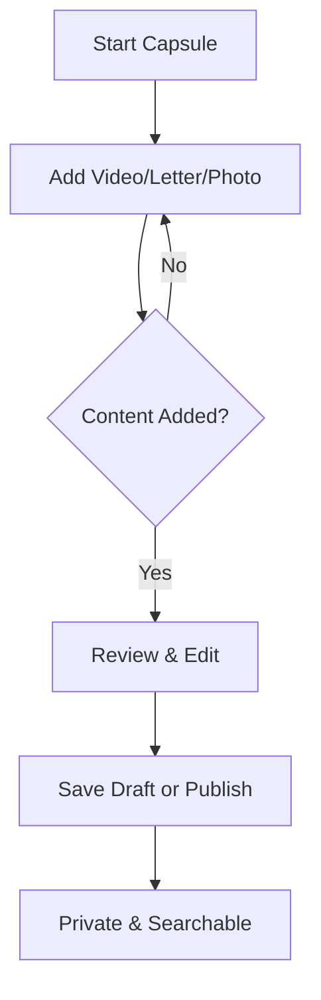

## Overview

Build a time capsule in ParentSearch to preserve your messages, letters, and memories for your child. This guide walks you through recording video messages, writing letters, uploading photos and keepsakes, and managing your content. Your capsule remains private until your child searches for it.

<Callout kind="info">
  Capsules are encrypted and private by design. Only your child can access them using their search.
</Callout>

## Step-by-Step Creation Process

Follow these steps to build your first time capsule.

<Steps>
  <Step title="Sign Up and Start" icon="user-plus">
    Create your account at [https://parentsearch.org/join](https://parentsearch.org/join). Verify your email and set up your profile with your child's details.
  </Step>
  <Step title="Create New Capsule" icon="plus">
    From the dashboard, click `New Time Capsule`. Enter a name like `Messages for Alex` and optional description.
  </Step>
  <Step title="Add Content" icon="upload">
    Use the tabs below to record videos, write letters, or upload files. Aim for 5-10 items to start.
  </Step>
  <Step title="Review and Save" icon="check-circle">
    Preview your capsule, then save as draft or publish. Published capsules are searchable.
  </Step>
</Steps>

## Adding Content Types

Choose from video, letters, or photos using the intuitive interface.

<Tabs>
  <Tab title="Video Messages" icon="video">
    Record heartfelt videos directly in the browser.

    <Steps>
      <Step title="Start Recording">
        Click `Record Video`. Allow camera access.
      </Step>
      <Step title="Speak Your Message">
        Share memories, advice, or love. Keep under 5 minutes.
      </Step>
      <Step title="Edit and Save">
        Trim clips, add captions, then `Save to Capsule`.
      </Step>
    </Steps>

    <Image
      src="https://parentsearch.org/video-record-example.png"
      alt="Video recording interface in ParentSearch"
      width="800"
      height="450"
    />
  </Tab>
  <Tab title="Write Letters" icon="edit-3">
    Compose timeless letters for different life stages.

    1. Select `New Letter`.
    2. Choose template: `Birthday`, `Advice`, or `Blank`.
    3. Write your message. Use rich text for bold, italics, or lists.
    4. Schedule visibility: `Anytime` or `Age 18+`.
    5. Save and preview.

    <Callout kind="tip">
      Date your letters for chronological order.
    </Callout>
  </Tab>
  <Tab title="Upload Photos & Keepsakes" icon="image">
    Preserve memories with images, scans, or documents (PDF, up to 10MB).

    Drag and drop files or click `Upload`. Add captions like `Your first birthday, 2010`.

    Supported formats: JPG, PNG, PDF, MP4.
  </Tab>
</Tabs>

## Managing and Editing Content

Organize your capsule efficiently.

<Columns cols={3}>
  <Card title="Edit Items" icon="edit" href="/guides/editing">
    Update messages, reorder items, or delete outdated content anytime.
  </Card>
  <Card title="Preview Capsule" icon="eye" href="/guides/preview">
    See exactly what your child will experience.
  </Card>
  <Card title="Add Milestones" icon="calendar" href="/guides/milestones">
    Set future unlock dates based on age or events.
  </Card>
</Columns>

<Board title="Capsule Workflow">
  <BoardColumn title="Draft" color="0" icon="edit-3">
    <BoardCard title="Video: First Memory" description="Record birthday message" />
    <BoardCard title="Letter: Advice for Teens" />
  </BoardColumn>
  <BoardColumn title="Review" color="1" icon="eye">
    <BoardCard title="Photo Album" description="Upload 10 childhood pics" dueDate="2024-12-31" />
  </BoardColumn>
  <BoardColumn title="Published" color="2" icon="check-circle">
    <BoardCard title="Welcome Video" description="Intro to capsule" createdAt="2024-11-15" />
  </BoardColumn>
</Board>

<Expandable title="Advanced Editing Tips" default-open="false">
  - Bulk upload up to 50 photos at once.
  - Use tags like `milestone` or `holiday` for easy search.
  - Export capsule as ZIP for backup (excludes videos).
</Expandable>

## Best Practices

- Start small: 3-5 items spark curiosity.
- Be authentic: Speak from the heart.
- Update annually: Add new messages.
- Privacy first: No personal details beyond your story.

<Callout kind="success">
  Your capsule proves love endures. Keep building.
</Callout>

<Columns cols={2}>
  <Card title="How It Works" icon="help-circle" href="https://parentsearch.org/howitworks" target="_blank">
    Learn the full search process.
  </Card>
  <Card title="Support" icon="life-buoy" href="/guides/support">
    Get help from our team.
  </Card>
</Columns>